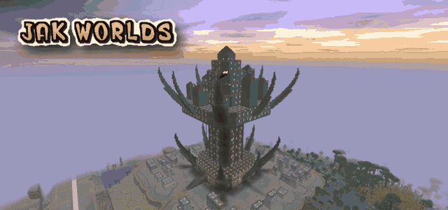

[Inicio](README.md) · [Descargar](https://github.com/AdriiSuizo/jak-minecraft-java/releases/tag/v0.1.0-dev.18) · [Guías](docs/README.md)

---

# Lo que falta portear del Rust (lista viva)

Fuentes: `Desktop\Repo\AUDITORIA-JAK-JAVA-2026-11-05.md` (§5.1, §10) y el registro final del Rust
(`Documents\Codex\2026-10-25\contin-a-el-trabajo-jak-minecraft\outputs\CONTINUACION-JAK.txt`).
Regla: cada cosa se portea de su función en el Rust (y este del OpenGOAL), sin inventar datos.
Lo que sea un sustituto se marca en el código con `stand-in:` diciendo qué hace el original.
El HUD queda fuera salvo que se pida. Una partida de prueba por lote, no por línea.

Estados: HECHO · EN CURSO · PENDIENTE · FUERA (HUD/no pedido)

## Hecho (05/11)
- HECHO Vuelo de Jak luminoso gratis; creativo sin munición infinita; receta JET-Board y recetas Rust.
- HECHO Golpes → grietas → vehículo como objeto con casco; eco verde repara; zoomer hundido vuelve como objeto.
- HECHO HellCat: un golpe lo apaga, tres lo desmontan.
- HECHO Mezcla de volumen del Rust y pasos vanilla silenciados bajo Jak.
- HECHO Sesión nativa conservada al teletransportar y cambiar de dimensión; mutex de vehículos recuperable; aviso si falta la DLL.
- HECHO Biomas Jak: Páramo, Montaña Nevada, Pantano (terreno, octavos, agujas, mesas, palmeras); sin aldeas ni pirámides vanilla en desiertos.
- HECHO Puñetazos y patadas rompen bloques con la fórmula del Rust (daño ×100/8 ÷ 160 ÷ dureza); el bloque es el que toca la esfera de golpe del núcleo.
- HECHO FPS: el mando cuenta como actividad (Minecraft bajaba a 30 FPS al minuto y a 10 a los 10 min); el modelo de Jak ya no genera ~40 MB/s de basura.

## Hecho en el lote de la noche (05/11, instalado 19:22; compila; probado en partida solo lo marcado ✔)
- HECHO ✔ Puñetazos: daño a todos los bloques que toca la esfera de golpe del núcleo (6 de tierra con 13 golpes).
- HECHO ✔ Cámara: recorte redondo de paredes entre cámara y Jak (pilar comprobado); K rescate y desatasco (sin probar).
- HECHO ✔ Nidos y bandas por bioma (se vieron en el registro); reposición 240 s, merodeadores nocturnos, depredador junto a aldeas (sin probar).
- HECHO Cielo de Jak 1 / clima Jak 3 / relámpagos (carga las 32 partículas originales; revisar a ojo).
- HECHO Eco oscuro líquido, cubo, muerte por eco oscuro.
- HECHO Raíles de grind colocables (auto-unión de raíl vanilla); L2 de tabla y giro de suelo al núcleo.
- HECHO Ragdoll del Grunt al morir (47 articulaciones, 120 Hz).
- HECHO Ciudadanos: rutina, puertas y casas, poses, pánico, pasos, eco verde, tamaño aleatorio, campana, 5 habitantes de Jak 1, monjes.
- HECHO Explosión de vehículos con carcasa y restos; marchas del HellCat, roce con hojas, depósito de carbón.
- HECHO 19 fachadas, objetos sueltos, Spargus en desierto, Sandover de nieve/pantano, texturas por posición.

## Hecho en el lote de la tarde-noche (05/11, instalado 21:20; probado en partida lo marcado ✔)
- HECHO ✔ Agarre a bordes: muros de 2 y de 3 bloques. Causa: al teletransportarse, el núcleo volvía al cuerpo original de 0,7 m (demasiado gordo) y chocaba antes con el muro.
- HECHO ✔ Escalones: un bloque entero no se sube andando (se para delante); una losa sí.
- HECHO ✔ Puñetazos: primero el bloque marcado por Minecraft, después el de debajo (2 por muro).
- HECHO ✔ Sandover rojo vuelve a generar (llanuras y bosques), junto al nevado y al del pantano.
- HECHO ✔ Tráfico de zoomers en Haven, encendido por defecto (JAKMC_TRAFICO=0 lo apaga): solo por calles del plano libres en el mundo y con sitio para dos carriles; en cada cruce elige calle al azar, da la vuelta en los callejones, frena ante peatones.
- HECHO ✔ Conductores con el modelo original citizen-norm-rider (postura de moto o coche, se inclina con el giro), pegados al movimiento suavizado del zoomer (antes iban en pose T y a 20 Hz).
- HECHO Nombres en español de ~1.200 bloques y objetos (tabla tools/nombres_es.py que usa el generador). Los nombres de armas son traducción propia, no los oficiales.
- HECHO La tabla flota sobre el eco oscuro como sobre el agua (los zoomers ya flotaban sobre cualquier líquido).
- HECHO JakLands ya no pisa cofres ni otros bloques con entidad de las estructuras.

## Hecho 05/11 21:38 (instalado)
- HECHO ✔ Grunt: un golpe que no le mata lo tira como muñeco de trapo (la misma caída de 47 articulaciones que al morir); otro golpe en el aire lo empuja más; cuando se para se levanta con grunt-getup-front o -back según cómo haya caído; si muere estando en el suelo, su caída de muerte sigue desde ahí.

## Hecho 05/11 22:01 (instalado)
- HECHO ✔ Rayo: su destello ilumina el mundo (luz del cielo + 0,6 × destello, como minecraft_world.rs); respeta la opción de Minecraft de ocultar destellos.
- HECHO ✔ Niebla como el Rust: color de la niebla de Jak por hora y clima en lugar del de Minecraft, y la distancia acortada por el clima (fog_distances). Quitada la mezcla de inicio de tormenta de arena que el Rust no tenía.
- HECHO ✔ Gradación de color de Jak Enhanced Trilogy (licencia ISC en third_party/jak-enhanced-trilogy): campo, bosque, desierto, pantano y nieve, de día y de noche, mezcla de 1,5 s. IW4L_ENHANCED_GRADE=0 la apaga. Es sutil, como en el Rust.

## Hecho 05/11 22:20 (instalado)
- HECHO ✔ Población de ciudades como el Rust: al acercarse Jak (150 bloques) el barrio de Haven se llena hasta 28–44 ciudadanos (salió 40) y Spargus hasta 6 (como mucho una persona por cama), repartidos por sus calles; al volver tras alejarse más de 220 se completa otra vez. Ya no salen residentes al generar el mundo en esas dos ciudades. Las calles con gente hacen frenar al tráfico.
- HECHO ✔ Spargus repone sus 2 leapers sueltos.
- HECHO ✔ Alarma: el segundo golpe de Jak al mismo ciudadano (no a los de Spargus) pone a los guardias contra él 30 s, más 3 s que esperan mientras alguno le persigue; luego se calman. Sustituye a la regla anterior de "dos golpes vistos por un guardia".
- Sin comprobar en partida: que los guardias de verdad vayan a por Jak durante la alarma (en la prueba Jak volaba alto y no le veían).

## Hecho 05/11 22:45 (instalado)
- HECHO ✔ Carcasa del HellCat como el Rust: destellos amarillo/naranja 0,6 s y después oscurecida a un cuarto.
- HECHO ✔ El HellCat al explotar tira a Jak (dentro, subiendo o a menos de 3 m): un metro sobre el asiento, a media velocidad del HellCat y 12 m/s hacia arriba.
- HECHO ✔ Carcasas de zoomers y coches oscurecidas a un cuarto (antes sin luz) y trozos negros; el Saltadunas y el Arenatiburón conservan sus ruedas en la carcasa.
- HECHO ✔ Morir en eco oscuro lanza la ráfaga original group-dark-eco-death de Jak 1 (además del sonido que ya había).
- Escena nueva de prueba: tools/run_scene.py --scene wrecks.

## Hecho 06/11 00:16 (instalado)
- HECHO ✔ L2 con un arma en la mano solo apunta: ya no abre puertas ni monta en vehículos (Adrii 05/11). Sin arma, L2 sigue siendo el "usar" de Minecraft.
- HECHO ✔ Jak Claro, parar el tiempo como en Jak 3 (`target-lightjak-freeze`): ahora es un estado propio con la palmada (jakb-lightjak-freeze, del fotograma 0 o del 9 si ya llevaba 2 s como Jak Claro, hasta el 20). Al chocar las manos: destello de la mano izquierda, vibración del mando 0,5 s y sacudida de cámara (smush 819.2/15/75/0.9). El mundo empieza a frenarse en la palmada, no al pedirla. Si se pide antes de transformarse, la palmada llega tras el get-on.
- HECHO ✔ Pantalla con el tiempo parado: filtro azul (1, 1, 1,5) y la mezcla del fotograma anterior con estelas hacia los bordes, sacados de OpenGOAL (blit-displays.gc y los shaders slow_time, licencia ISC en third_party/opengoal).
- HECHO ✔ Escudo como en Jak 3 (`target-lightjak-shield`): un estado propio. Al subir el escudo, Jak gira 7,5°, da un saltito (8,25 m/s), hace la patada con su desplazamiento y el sonido SPIN_KICK, y vuelve a estar de pie o cayendo. Patea una vez por cada escudo, al entrar a estar de pie, saltar, caer o aterrizar.
- HECHO ✔ Los poderes de Jak Claro ya no se pisan: volar es su propio estado (las alas no se pierden por usar otro poder después) y la palmada y la patada son estados aparte, como la curación. Lo único que se excluye es lo que excluye el original: el escudo no sube mientras el tiempo está parado ni en los 0,5 s después de curar.
- HECHO ✔ Tirón al sacar el escudo por primera vez: la textura animada del escudo y de las alas (de 0,3 s) se prepara al cargar, fuera del hilo del juego. Medido: el fotograma de 344 ms ya no aparece; con el escudo abierto, 13,4 ms de mediana frente a 13,1 sin él.
- Arreglado en las escenas: munición en el mundo nuevo (escena de poderes), un bloque picado por pulsación de R2, el paso de sacar la tabla con Triángulo (escena de mando).
- Avisos de licencia ISC en el instalador: OpenGOAL y Jak Enhanced Trilogy (licenses/).

## Hecho 06/11 00:59 (instalado)
- HECHO ✔ Tráfico de Haven por una calle de ronda (Adrii 06/11): los zoomers dan vueltas en un solo sentido por el borde del barrio, 16 calles, sin callejones ni vueltas en U y sin tocar el palacio. Si alguna calle del borde está tapada en el mundo, vuelve a la red de antes.
- HECHO ✔ Los ciudadanos se apartan de la calzada cuando viene un coche, como el aviso `'clear-path` del tráfico de Jak 2: se van al hueco libre más alejado a su lado, hasta 10 m. Ya no salen ciudadanos nuevos en la ronda ni en sus cruces. En la prueba, los coches iban a unos 8 m/s sin nadie delante.

## Hecho 06/11 (lote 2–11; probado en partida lo marcado ✔, una vez por escena)
- HECHO ✔ Rana del pantano con lengua eléctrica (punto 11). La rana con lengua de los originales es `kermit`, de la ciénaga de Jak 1 (levels/swamp/kermit.gc); el "hopper" de la selva no tiene lengua. Portada función por función: salta para quedarse a 10 m de su presa; si la tiene a menos de 12 m y con la cabeza a menos de 20°, saca la lengua (kermit-lash; en el fotograma 14 decide si acierta; si falla se queda en 0,8 y la recoge). Si acierta, la lengua se queda pegada y un pulso eléctrico la recorre a 0,3 por segundo (partículas originales group-kermit-pulse y su impacto, sonidos kermit-loop, kermit-stretch y get-shocked). Al tocar a la presa le hace 2 de daño. Se suelta si la presa se aleja más de 18 m, si algo tapa la lengua o a los 4 s. Ataca a Jak y también a mobs y animales. A Jak la lengua le tuerce la dirección del stick hacia la rana (target-apply-tongue: 0,15 a 5 m, 0,22 a 15 m). Como en el original, si Jak está quieto no lo arrastra. Vive en pantanos (una banda propia de dos ranas) y tiene huevo "Generar Rana del pantano". En la prueba: a Jak y a una vaca, lengua pegada, pulso visto y 2 de daño a cada uno.
  - Sustitutos: no hay malla de navegación (se usa la línea de visión y la colisión de Minecraft); el cuello no gira por separado (manda el cuerpo); a los mobs no les tuerce la marcha; con la lengua pegada Jak puede seguir atacando.
- HECHO ✔ Tirón de Jak Claro la primera vez (punto 2): en los tres primeros fotogramas se dibujan, diminutos, el cuerpo luminoso, el oscuro, las alas y el escudo para que la tarjeta gráfica los prepare antes. Medido: el peor fotograma del escudo pasa de 111 a 50 ms y desaparecen los de 69–111 ms.
- HECHO  Nidos de la cueva del cráter (punto 5): la marca CAVE_MARK de la cueva crea un nido con su banda de cueva. Los enemigos invocados con comando o huevo pasan a ser merodeadores nocturnos, como en el Rust. Sustituto: la banda de cueva no mira la luz (el Rust la ponía con faroles y lava, y por eso nunca salía).
- HECHO  Jak oscuro (punto 6): las víctimas de sus rayos se tiñen de morado mientras les dura, y la Fuerza suma +3 por nivel a los golpes (Debilidad resta 4 por nivel, sin bajar de 0).
- HECHO ✔ Super Nova como bomba (punto 6b): explosión de potencia 16 que rompe el terreno como un TNT enorme, daña y empuja a todo menos al que dispara y su vehículo. Se ve la seta original (mushroom de Jak 3, animada 4 s), destello blanco 2 s, vibración y sacudida de cámara al segundo.
- HECHO  Flut Flut salvaje (punto 7): si lo golpean entra en pánico 5 s, sale despedido y huye zigzagueando; tras un intento de doma fallido, 3 s de pánico. Suelta 1–3 de pollo crudo, 0–2 plumas y la silla. Se puede atar con correa. Las crías siguen al adulto más cercano.
- HECHO Parpadeo de Jak y Daxter (punto 8), con la tabla original de eye.gc (cada 60–240 fotogramas).
- HECHO Del registro final del Rust (punto 9): succión de gemas con su rampa original y bloqueada al colector, guardada en el mundo; caída lenta: Jak cae como mucho a 4 bloques por segundo (no con el Flut Flut). La barra del Hip Hog no hacía falta (sus 103 celdas ya tienen suelo).
- HECHO Lote de la comparación (punto 10):
  - Lava: Jak nada en ella y arde (fuego ≥ 15 s pisándola, 1 de daño por segundo dentro); el escudo apaga el fuego e impide el daño de lava y fuego.
  - Hambre: correr 0,05 por bloque, saltar 0,05, golpe que acierta 0,1.
  - Patadas: abren puertas, trampillas y pulsan botones; una patada toca la campana (un golpe de suelo la rompe).
  - Inversor de masa sobre mobs: los deja flotando, al golpearlos dan vueltas, caen como hayan quedado, se quedan tumbados y se levantan despacio (tumble.rs).
  - HellCat sobre agua, lava y eco oscuro: el líquido es un suelo plano para él y sale hacia arriba si se hunde.
  - Invisibilidad: oculta a Jak y a Daxter y los enemigos lo ven solo de cerca. Salto potenciado: más salto de Jak.
  - Primera persona: balanceo del arma al andar y retroceso al disparar.
  - (Quitado el 06/11: el saltador del skatepark, nadie lo pidió; en su lugar el lanzador de eco azul.)
  - Sin probar en partida: lava, hambre, patadas, HellCat en líquidos, invisibilidad y balanceo (compilan y siguen el original, pero no hay escena para ellos).

- HECHO ✔ Con arma en las manos, la tabla a la espalda va con el torso (Adrii 06/11): la tabla cuelga de la cintura y se quedaba con la animación de andar mientras el torso hacía la de arma; ahora toma también la de arma, como en el original. Visto en las capturas de la prueba de armas.
- HECHO Daxter con arma (Adrii 06/11: su brazo derecho atravesaba el pelo y la frente de Jak): Daxter seguía con su animación normal mientras Jak hacía la de arma. Ahora hace la suya del original (daxter-gun-stance, -walk, -fire, -takeout…), como en sidekick.gc. Visto solo desde detrás en la prueba; falta mirarlo de frente.
- HECHO ✔ El Inversor de masa deja sin gravedad a todo, también a los objetos (Adrii 06/11): objetos tirados, flechas, barcas, vagonetas, bloques que caen, TNT y orbes de experiencia flotan igual que las criaturas (suben a 1 m del suelo, se quedan entre 1 y 3,5 m, 7–9 s, y luego caen). El campo crece hasta 30 m en su primer segundo, como el original. Los jugadores no. En la prueba de anillos atrapó 22 objetos; unas piedras, una barca y una vagoneta subieron 1 bloque.
- Arreglado en la prueba de armas: un mundo nuevo empieza sin munición y las armas no disparaban; ahora carga munición de cada color. Con eso, las 12 disparan otra vez (la Super Nova rompe el suelo).
- Sin comprobar en partida con medida propia: tinte de Jak oscuro y bono de Fuerza, nidos de la cueva, pánico del Flut Flut (sus escenas pasan, pero no miden eso).

## Lote de Adrii 06/11 (18 puntos + esclusa)
- HECHO Pasos sobre hojas de árbol suenan a hierba; agarre a bordes con la altura del Rust (1,9 bloques) y suelo bajo Jak buscado más abajo.
- HECHO Menú creativo: el stick derecho es la rueda del ratón esté donde esté el puntero.
- HECHO Decoración: mira hacia donde mira el jugador al ponerla; jarrón y palmera con caras por los dos lados; barriles opacos.
- HECHO Iconos: los objetos y bloques de Jak sin icono propio usan su modelo 3D (43 objetos, 1.223 bloques).
- HECHO Vista previa al 18 % de los objetos de más de un bloque (también las puertas 3x3).
- HECHO Alcance para poner bloques ×3; el de romper y atacar, igual.
- HECHO Fuego del bidón más grande y más bajo (escala de bloque del Rust).
- HECHO Quitado el saltador del skatepark. Lanzador de eco azul de Jak 1 (citb-launcher): solo con eco azul; Jak se agacha, sale con el salto de lanzador de Jak 3 (target-launch → duck-high-jump 'launch, 40 m de muelle, launch-jump-mods).
- HECHO Puerta iris de la Roca del Géiser, 3x3, solo las aspas: se abre con eco azul cerca (8 m) y se cierra al alejarse (stand-in: la original se queda abierta).
- HECHO Esclusa de Villarefugio (com-airlock-outer y -inner espalda con espalda), 3x3: se abre a quien se acerque y se cierra al irse; cada cara con su animación de airlock.gc y sus sonidos de CTYWIDE1, de un bloque de grosor y acelerada para que abrir o cerrar dure como mucho 2,5 s (Adrii; stand-in: 8/12 m en vez de 35 m; no carga zonas).
- HECHO JET-Board: el agua y el eco oscuro son suelo para la tabla (la lava no) y los lados de bloque cuentan como suelo para subir; la tabla a la espalda ya no se deforma (se copiaban las poses guardadas).
- HECHO Jak luminoso con su propio pase opaco, sin transparencias (mismo coste que antes).
- HECHO Villarefugio: hasta 48 guardias por ciudad en sus puestos, reaparecen de día; atacan a los mobs hostiles. Cada ciudadano toma una cama libre de la ciudad.
- HECHO Tráfico: los zoomers con ruta no dan marcha atrás; si se atascan 2 s pasan del obstáculo que no es jugador; choques entre zoomers; vaivén suave del Rust.
- HECHO Jak oscuro: los golpes normales no gastan eco; al volver a Jak con menos de un punto queda a 0 (antes quedaba un resto invisible); el HUD redondea hacia arriba.
- HECHO Bomba oscura (X+Cuadrado, target-darkjak-bomb0): con 5 de eco oscuro o más (el 50 del original, a la décima como los golpes); sube, cae con gravedad extra y al tocar suelo explota en una esfera que crece hasta 30 m, 15 de daño; gasta 10 (100 en el original). Explosión oscura (X+Círculo, o agachado+Círculo como el original; target-darkjak-bomb1): sube, flota 1,5 s y lanza un rayo cada 0,1 s a cada criatura en 80 m, 15 de daño y la congela (congelación de Minecraft); gasta 10. Las dos dejan a Jak oscuro (Adrii; el original vuelve a Jak). La bomba dibuja su cúpula (bomb-blast y generic-blast de Jak 3: blanco, morado, negro en 30 cuadros).

- HECHO Todo lo decorativo se fabrica: 1.288 piezas de Jak (vallas, tejados, escaleras, objetos sueltos…) en el cortapiedras desde un bloque del material de su lugar (arenisca en Spargus, ladrillo de piedra en Villarefugio, cuarzo en el palacio…) o de lo que es (madera, hierro, cristal, tela, hojas). Lanzador y puertas en la mesa de crafteo.
- HECHO Desierto de Jak: sus texturas (arena, roca, acantilados, cuevas, hierba seca, piedras, palmeras, roca roja, tótem) no estaban en los niveles que lee el exportador y salían rayas de relleno; ahora son las de las páginas de texturas de Jak 3. La arena, a sus 128 texeles, se extiende sobre 4x4 bloques sin girar, como en Jak 3. Siguen de relleno vil1-medres-hutroof y snow-gate-wood (no están en ninguna página).
- HECHO Tests: cada uno crea un mundo nuevo y borra todos los anteriores (los ajustes del mundo quedan en .local/test-world-template).

## Lote de Adrii 06/11 tarde
- HECHO Enemigos nuevos en el agua: flotan con su animación normal, sin bucle de nado (los guardias de Krimson siguen pataleando como en Jak 2).
- HECHO Jak nada a la profundidad del port en Rust (el agua usaba el tamaño 0,64 y no el que se dibuja) y su salto desde el agua sube lo del Rust; la cabeza queda fuera (joint de pelo).
- HECHO Eco luminoso: icono de inventario de Jak 3 (inv-items-lighteco-01). Láminas y barrotes con icono plano, como los cristales de Minecraft.
- HECHO Follaje de Villarefugio: tiene objeto en la mano y ya no deja ver a través del mundo (bloques con huecos en la textura no tapan a sus vecinos). Bidón ardiente también tenía el objeto perdido.
- HECHO Quitadas las rocas pequeñas del palacio. Rocas de Spargus y del pantano niveladas y con la base cerrada (stand-in: las originales están sobre pendiente).
- HECHO Agarre a bordes: Java enviaba caras ocultas entre bloques como si fueran bordes; ahora se quitan como en el Rust, y no se engancha si la pared sigue por encima del borde (stand-in de seguridad).
- HECHO Esclusa: se abre y cierra con clic izquierdo o L2 (mayús+clic la rompe), sonidos más bajos, colisión de bloque donde está y donde quedan las hojas abiertas.
- HECHO Puerta iris: su marco se queda al abrir, con el borde de fuera cuadrado; suena irisdoor2 de Jak 1 (stand-in: la original solo suena el eco azul).
- HECHO Lanzador: encima del bloque, sonidos igualados, colisión solo en su bloque; lanza al saltar encima con eco azul, no al ponerse (stand-in pedido por Adrii).
- HECHO Eco azul: rezuma de Jak (powerups.gc target-powerup-process, también amarillo, rojo y verde) y reloj de eco de Jak 1 a la derecha (hud-pie, hud-ecometer, harddot; solo si esas texturas están en una exportación de Jak 1).
- HECHO Eco oscuro líquido: el instalador no generaba sus texturas (import_dark_eco.py no estaba en el instalador).

## Zoomers 06/11 noche (humo y llamas, subir y bajar, cuesta)
(Compila y pasan los tests nativos; sin ver todavía en el juego: se mira en la pasada única del coordinador.)
- HECHO Humo y llamas del zoomer (vehicle-method-78, hvehicle-method-78, vehicle-draw-thruster, vehicle-method-135): nacen cada fotograma de 60 Hz en la matriz del hueso tal como se dibuja la moto (casco, vaivén y escalón), con las posiciones, ids de parte (923 escape, 922 llamas, 925/928/930/921 daño, group-vehicle-engine-start), cantidad/alfa/velocidad por engine-power-factor, power-level y velocidad del vehículo. Antes nacían en la última instantánea del servidor (unos 2 ticks por delante de lo dibujado) y 3 veces en el mismo sitio.
- HECHO Brillo (sprite-glow) del propulsor a un cuarto de la llama, y las luces del zoomer siguen la misma elevación con que se dibuja la moto.
- HECHO Subir al zoomer (target-pilot-get-on): duración = la del clip (moto 1,0 s, coche 1,47 s), trans en seno de cuarto en horizontal y recta en vertical hasta el fotograma 10, orientación con el mismo seno, controles desde el fotograma 20,5 (pilot-on), 0,1 s de mezcla al bucle sentado.
- HECHO Sentado (target-pilot-trans): left-right/front-back/up-down salen de la aceleración del vehículo (suma de 8 fotogramas por 0,5, factores de target-pilot-init), del giro, de lean-z y del vaivén de 0,03; reemplaza el giro/aceleración directo de antes.
- HECHO Bajar (target-pilot-get-off): animación hasta el fotograma 7,2 (moto) o 15,2 (coche) a doble velocidad, salto de 2,5 m con la velocidad del vehículo (+ palo, tope 30 m/s) con *pilot-get-off-mods* (sin fricción) y caída normal; desde la propia silla, no al lado. El estado ya existía en el núcleo pero la animación nunca llegaba a reproducirse (ja_loop la cambiaba por un bucle): corregido.
- HECHO Jak sobre la silla de la moto tal como se dibuja: antes el casco subía un bloque de golpe al trepar un escalón y la moto lo seguía suavizada pero Jak no.
- HECHO Balanceo (hvehicle-physics.gc apply-gravity!, roll-thruster-array; native/jak-core/src/roll.rs): el ángulo de balanceo es la dinámica del cuerpo rígido con sus números (mass, inertial-tensor-box, angular-damping 0,995, roll-control-factor, player-weight 40 a player-shift-x 0,6 m por el giro; cada propulsor de balanceo solo empuja del lado que baja, con sin³ + 0,075 de la velocidad angular, más la fluctuación de potencia). A tope de volante se inclina unos 37° (los números del original); sin jinete no se inclina (riding). Sustituye el suavizado inventado de 20°. Stand-in: los choques del casco no dan par de balanceo, y el balanceo del terreno (tilt) sigue siendo aparte.
- HECHO Llamas de los propulsores de balanceo (h-bike-base vehicle-method-78 + vehicle-draw-thruster): posiciones y direcciones del original, longitud 3 m × empuje (roll-thrust·force-scale·inv-mass/gravity) × 1–1,33, ancho 0,4 m, tres láminas a 60° (el mismo vehicle-draw-thruster que las traseras, ahora una sola función), y su brillo. Sonido "bike-thrust" a 0,32·4·empuje/max-engine-thrust, media octava arriba. Stand-in: sputter-sound-envelope = 1 (es el power-level, dentro de un pelo).
- HECHO Roce (vehicle.gc on-impact, vehicle-method-78, rigid-body-object-method-38): deslizar sobre algo a más de 3 m/s pone scrape-sound-envelope a 1 (baja 2 por segundo), chispas part 920 en impact-pos mientras sea ≥ 0,75, sonido bike/car-scrape-stn con esa ganancia en ese punto. Stand-in: impact-pos es el punto del casco (caja) más cercano a lo que roza, no el contacto del cuerpo rígido.
- HECHO damage-zaps / damage-pops pedidos por nombre (vehicle-method-78: chispa de 921 a 0,5 %; hvehicle method 38: rand < power-fluctuation-factor). OJO: esos dos sonidos no están en NINGÚN banco SBK del Jak 3 de Adrii (se buscó en todos), así que el original tampoco suena; si se importan, suenan solos (JakEnemySounds.find).
- HECHO IK de las manos al manillar (joint-mod-ik-callback, target-pilot-post, vehicle-method-113): ArmIk.java es el algoritmo del original (ley de cosenos, giro del hombro, torsión sobre el polo) con la mezcla 4/s de joint-mod-ik; objetivos de las manos = asiento + rider-hand-offset (moto) o rider-hand-offset en el joint del volante (coche, girado como se dibuja). Encendida sentado y en los golpes, apagada al subir (target-pilot-get-on usa target-no-move-post). Comprobada aparte con 171 comprobaciones de la matemática (longitudes, alcance, lado del codo, mezcla). Stand-in: al bajar (get-off) no se aplica (es otra sesión de Jak).
- HECHO target-pilot-impact (native pilot.rs): con aceleración x/z del fotograma > 2048000 u/s² estando en stance, elige el clip por la aceleración local (x·4, y, z normalizados contra 0,707: derecha/izquierda/atrás/delante/shock), arranca en el fotograma del original (coche: delante en aframe 4 a 1,3×, atrás en aframe 2), mezcla 0,05 s dentro y 0,1 s fuera, y borra la aceleración al acabar.
- HECHO target-pilot-hit / target-pilot-death (JakVehicle.riderHit, JakPilotDeath): lo que llega al jinete (explosión, fuego/lava, rayo, vacío) lo mata; 'explode y 'melt a los 0,2 s: sonido ("explosion", "death-melt"), explosión group-explode-death / group-lava-death (target-part.gc de Jak 3, añadidos a la biblioteca) y Jak deja de dibujarse 1,8 s; 'endlessfall suena "death-fall" (no está en los bancos: silencio). Stand-in (CAMBIO DE JUEGO a vigilar): los golpes de mobs y flechas, que en el original recoge la forma del vehículo, siguen solo hiriéndole, y no cuentan asfixia, caída, cactus, ahogo.
- HECHO fog-fade (calc-fade-from-fog): luces y llamas del zoomer (y el brillo) escalados por 240/255 → 130/255 según la distancia a la cámara contra el inicio/fin de la niebla que se dibuja. Stand-in: los 240/130 son los comunes de mood-funcs.gc, y inicio/fin los de la niebla de Minecraft.
- HECHO Bajar de una moto parada: el vehículo del que acabas de bajar es sólido para ese Jak (caja de su casco hasta el asiento, cerrada, solo bloquea desde fuera) durante un minuto y a menos de 8 bloques: sube atravesándolo desde dentro y cae sobre él o a su lado. Stand-in: en el original los vehículos son siempre sólidos.
- HECHO JakVehicle pone setDeltaMovement (bloques por tick): ZoomerTraffic.clearPath ya ve la velocidad.
- Sin sonido hecho: el bucle thrust-sound del hvehicle y el motor siguen siendo los de antes (aproximados), fuera de lo pedido.
- Diagnóstico: JAKMC_ZOOMER_PROFILE=1 escribe cada 5 s en el log cuánto tarda cada parte del zoomer (servidor y cliente) y los FPS.

## Pendiente, por orden
- Nada del Rust en la lista. Lo siguiente lo decide Adrii.

## Fuera por ahora
- Golpes de mobs que llegan 0,45 s después del gesto (Adrii 06/11: quitado de la lista).
- Fachadas: etiquetas de pico/hacha y regla por cabaña de Sandover; destello de la Super Nova (Adrii 06/11: quitados de la lista).
- FUERA (Adrii 05/11) Creativo como el Rust; triángulo "lo usable más cercano"; kit inicial; desgaste de armas; portal al skatepark de Jak 2 (ya hay parte del skatepark en el centro de la torre de Villarefugio, con la tabla del altar).
- FUERA HUD de vuelo, iconos de armas, timer de Jak 1, anillo animado, sprites de botón (HUD).
- FUERA Menús UI42–UI69 1:1 del Rust (interfaz; preguntar si se quieren).
- FUERA Edit Blaster (sustituido por el Wave Concussor).

## Lote 06/11 noche: Supernova, cabeza, rendimiento, pasada en el juego (coordinador)
- HECHO Supernova de Jak 3 en pantalla (JakNukeScreen, de BlitDisplays.cpp de OpenGOAL): fundido blanco→naranja con las curvas del original (2 s; la pequeña 6 s), desenfoque radial de 10 texels (5 s), la música se calla mientras dura; sonidos de stream pg3nxplo (grande) y pg3wxplo (pequeña) sacados de VAGWAD.INT por tools/import_audio.py.
- STAND-IN Supernova: el zumbido de 3 s tras el destello (no se encontró su stream).
- HECHO Cabeza (Adrii 06/11): cuerpo del juego (jakb-c) con solo la cabeza de las cinemáticas (jakc-highres / darkjak-highres); Daxter del juego de Jak 3.
- HECHO Rendimiento: GltfModel calcula cada vértice una vez (no una por esquina); los planos de ciudad se leen una sola vez y fuera del hilo del servidor (quitaba un tirón de ~0,5 s al llegar a la primera ciudad). Banco (zoomer a fondo 60 s, ajustes de Adrii, -Xmx4G): 13,3 → 9,2 ms por fotograma de media, p99 33,7 → 20,9 ms. Se probó ZGC y es peor: se queda G1.
- HECHO Pantalla negra al colgarse de un borde o pegarse a una pared: Minecraft 26.3 pinta la capa de "cabeza dentro de un bloque" también en tercera persona, desde los ojos del jugador; ahora solo en primera persona (JakViewBlockMixin).
- VISTO en el juego (escena lote3): cámara en habitación con techo y pasillo (techo y pared de delante recortados), Jak encima del lanzador 5x5 (pies justo en su tope), buceo 4 bloques en 1,1 s, salir nadando sin daño, pausar en el zoomer sin bajarse, bajar desde arriba cae al suelo, humo y llamas siguen la moto en la cuesta.
- NOTA Subir al zoomer: el salto alto (3,2 m sobre el asiento en los fotogramas 3-5) es el de la animación original jakb-pilot-bike-get-on, no un fallo.
- HECHO Triángulos: las superficies opacas de los modelos se dibujan como triángulos (una copia de entity_cutout de Minecraft con topología de triángulos), no como quads con una esquina repetida.
- HECHO Ondas del agua: el modelo exportado traía la textura blanca de relleno (common-white) y se veía un disco blanco opaco; ahora lleva la suya (level-default-sprite/ripples, alfa de PS2 doblado). VISTO en el juego en agua de un bloque y honda: anillos sobre la superficie (+0,005 bloques).
- HECHO Al teletransportar a Jak se olvidan sus ondas (se dibujaban desde él y salían bajo el agua en el sitio nuevo).
- HECHO Reflejo (envmap) en la misma pasada que la base para materiales OPAQUE (entity.vsh/fsh JAK_ENVMAP, Sampler3 = mapa de entorno, Sampler0 = base sin mapear con su alfa como fuerza): una sola pasada en vez de dos. Las capturas se ven iguales. Los MASK/BLEND, Jak oscuro y los ojos siguen con la pasada aparte.
- NOTA Banco: pasados los primeros 15 s el zoomer cae en hoyos distintos en cada pasada (de 2 a 44 reapariciones), así que la media de 60 s no es comparable entre versiones. Mismo tramo (los 15 s iniciales, ruta idéntica): 71 fps al empezar el día → 128 (vértices + cabeza) → 132 (triángulos) → ~135 (reflejo junto); el mínimo 13 → 46 → 53 → ~60.
- PENDIENTE Optimizar más: el resto del coste es de Minecraft (BufferBuilder, terreno) y de la recolección de basura de la generación del mundo; el banco necesitaría una ruta fija para medir mejoras pequeñas.

## Lote 06/11 noche (2): bichos, yakow, árboles
- HECHO Bichos que suben escalones: la rana de la lengua (kermit) sube un bloque en sus saltos (stand-in: el original sigue el suelo de su malla de navegación; aquí su paso de salto sube 1 bloque, Kermit.STEP); el double-lurker, que no tenía salto propio, salta como en Minecraft. Probado en juego (escena lote4): 18 de los 19 bichos y el yakow suben a un escalón de un bloque; el depredador pega al yakow desde abajo (su alcance llega) y el guardia carmesí no persigue.
- HECHO Animación del yakow a saltos: el servidor mandaba el punto del clip cada 2 ticks; ahora el cliente lleva su propio reloj al ritmo del servidor y solo se corrige si se separa. En juego: 0 ticks parados de 183 andando.
- HECHO Agarre a árboles (Adrii 06/11): el árbol de Adrii (acacia de 5 troncos rectos, a su alcance) no se cogía porque sus hojas quedan a 2 bloques sobre el borde y la comprobación del original pide unos 2,4 bloques de sitio para subir saltando. stand-in (QoL): ese sitio no pasa de la altura de su cuerpo en Minecraft (1,8 bloques), así que donde un jugador cabe de pie, Jak se agarra y sube. Probado en una copia de su mundo (escena trees): se agarra por dos lados y sube; el lado con el tronco doblado encima y el de 6 bloques siguen sin poder (bien). Con hojas a 1 bloque, no.

## Lote 06/11 noche (3): munición, patada, cajas
- HECHO Iconos y modelos de la munición: los cargadores se veían solo a trozos (el final y el brillo) porque la pasada de reflejo junta con la base (dev.9) dejaba el alfa del material opaco, que es la fuerza del brillo, y donde se mezcla (barra, suelo) salían casi transparentes. Ahora el material opaco se pinta entero. Visto en juego: los cuatro cargadores completos en la barra y en el suelo.
- HECHO La patada rompe la hierba que toca (Adrii): las esferas del golpe de cada paso van a Java (attackSpheres) y, en patada, cada planta sin colisión ni dureza dentro (hierba, helechos, flores, brotes) se rompe de un golpe, como con el puñetazo. Solo plantas (no antorchas ni redstone). stand-in: el original no tiene plantas. El puñetazo sigue igual. En juego: las 6 plantas a su alcance cortadas, las demás intactas.
- HECHO Cajas de munición de Jak 2 (crates.gc, skel-crate-krimson, tipo madera como todas las de Haven): bloque con el modelo original, se rompe con cualquier golpe que la toque (patada, puñetazo, culetazo; el original: madera rompe con cualquier `attack`), suena wcrate-break y suelta su contenido: 20 de amarillo en recogidas de 10 o 20 de rojo en recogidas de 5 (drop-pickup). No vuelve. stand-in: las astillas de group-crate-explode no están exportadas (salen las partículas de tablones) y la caja se ajusta a su bloque.
- HECHO Repartidas por Villarefugio solo dentro de edificios (Adrii: todos, la torre y los guardias incluidos, no en las calles; el original las tenía en calles del suburbio y el mercado y en el palacio): sitio en suelo de edificio con techo a 4 bloques, junto a pared, lejos de puertas, barandillas, camas, cofres y escaleras; 1 de cada 32 (1 de 6 en el cuartel), 3 amarillas por cada roja. En juego: 35 cajas cerca del centro (16 casas, 2 bar, 2 cuartel krimson, 15 palacio y torre), todas con techo. Solo salen en la parte de la ciudad que se genera a partir de ahora.

## Lote 07/11: barriles, lámpara, brillo, cámara, patada, esclusas, showcase
- HECHO Barriles de nieve (objetos 24, 25, 26): dos bloques de alto y apoyados en el suelo (scale_objects en import_content.py).
- HECHO Lámpara: `hutlamp` de village-obs.gc como bloque jakmc:hut_lamp, colgada del techo del bloque, con su balanceo original (10 grados, periodo de 3 s, arranque al azar). // stand-in: la luz 15 del bloque; el original no tiene partículas ni luz propia.
- HECHO Brillo de Jak: el reflejo usa el tinte de cada material (mei-envmap-tint) y la luz de ambiente del original (foreground.gc), y se apaga con la luz del sitio.
- HECHO Caja de munición: group-crate-explode de crates.gc (astillas, destello y humo) además de las partículas de bloque.
- HECHO Esclusa de Villarefugio en todas las puertas de la torre y del edificio de la Guardia Carmesí (21 esclusas en el plano, 0 puertas viejas). Solo se ve en ciudades generadas de nuevo.
- HECHO Partículas al romper: Jak ya no se salta las partículas de bloque (levelEvent excluía al jugador), objetos de varias celdas, puertas y cajas sueltan partículas; auditoría de 3898 bloques, 0 sin partícula.
- HECHO Patada como tornado: daña todo lo que está en las esferas del golpe mire donde mire. Cada patada quita el 75 % de un bloque de tierra (cae en dos patadas), y esa misma cantidad a cualquier material según su dureza, una vez por patada y sin tocar el suelo que pisa Jak.
- HECHO Bancos 1, 2, 3 y farol de Villarefugio fuera (import_facade_parts.py).
- HECHO Cámara: atraviesa los bloques (solo la para el suelo de Jak). Con el ojo dentro de roca, el terreno se dibuja con relleno oscuro por detrás y un hueco alrededor de Jak: no se ve el cielo a través de las paredes. Luz mínima en Jak para que se le vea en cuevas.
- HECHO Mundo de showcase: ShowcaseScene (escena `showcase`) construye Spargus y Villarefugio juntos en un mundo normal y la jincana de estaciones entre los dos. Guía en docs/SHOWCASE.md.

## Lote 07/11 (2): eco oscuro del silo
- HECHO Aspecto: la piscina de finalboss (water-anim look 41) en terrain.fsh: textura negra con su fuerza moteada, environment-darkeco reflejado por tres olas de ripple-for-finalboss-dark-eco-pool. // stand-in: el mapa al cuadrado y normal-scale doble para un charco de pocos bloques.
- HECHO Corrientes: lo que fluye se dibuja como la piscina, sin hoja de flujo que gire.
- HECHO Destellos: group-dark-eco-pool-nasty salta al azar de la superficie (water-vol-idle).
- HECHO Al tocarlo: mobs y Jak mueren al instante con group-dark-eco-box-explosion y dcrate-break; los objetos desaparecen con la misma explosión al 30 %.

## Lote 07/11 (3): daño en bordes, buceo, esclusa 2x2, lanzador de Jak 1, burbujas

- Hecho y visto en el juego: agarrarse a un borde y la esquina de un bloque no hacen daño (interaction.rs in_wall: ojos dentro de un bloque entero); buceo solo sube con X; terrain_settle no tira de él nadando (quedaba atrapado en el fondo); esclusa 2x2 sin agujeros; reloj de eco girando como en Rust; salto del lanzador `eichar-launch-jump` y `sidekick-launch-jump` de Jak 1; aterrizaje del lanzador sin daño; explosión de items sobre la superficie del eco; burbujas paran en el nivel del agua.
- Auditoría de animaciones: 264 clips, 0 diferencias entre nativo y modelo; 5 clips de Daxter con el doble de frames ya escalados (`sidekickFrame`).
- Sin confirmar: enemigos sin animaciones erráticas (en la escena apenas se movieron); `eichar-launch-jump-loop` no llegó a verse en la escena (el salto aterrizó antes).
- Daxter se separa hasta 1,9 m del hombro en el salto del lanzador: es la animación original (`sidekick-launch-jump`, main.y de -0,78 a 1,92), no un fallo.
- Siguiente, auditoría de iluminación (por orden): tintes de la cabeza de cinemática (pelo el doble de brillante), desvanecido del brillo por distancia (`foreground.gc`), coordenadas del mapa de brillo en espacio de cámara (`emerc.vert`), luz local en la pasada de brillo aparte, suelo de luz neutro (decide Adrii), `update-environment-colors` y tablas de mood, luces de Jak que siguen al sol, `color-emissive`.

### Lote 07/11 (3), añadido: brillo de Jak y lanzador

- Hecho y visto: tintes de la cabeza de cerca (`jakc-highres-ag`), desvanecido del brillo por distancia (fade0/fade1 de cada tinte, `ENVIRONMENT_FADES`), coordenadas de `emerc.vert` en espacio de cámara (`emerc.glsl`), luz local en la pasada aparte (`// stand-in:`).
- Lanzador: clips de Jak 1 cargados al arrancar (parón de 297 ms en el primer salto), efectos propios esperan al reloj del cuerpo (`JakEffects.HELD`), sin pose de arma sobre `jakb1-launch-`.
- Medido con la cámara real: pies y cámara clavados (diferencia 0). El cuerpo sigue dando un brinco de 1,67 bloques en los fotogramas 2-3 del clip: `main` de `eichar-launch-jump` compensa su `align` (suman un arco suave) y el original lo tapa con su cámara con muelle. Adrii lo dio por bueno sin suavizar; si vuelve la queja, suavizar `main` en esos clips.
- Hecho y visto (`JakLightRig`, `entity.vsh`): luces de Jak por `mc_entity_light` de Rust con sol y luna, brillo por hora (tabla no-cloud de Jak 3), destellos de `target-color-effect-process`, suelo neutro (0,333 + 0,667 arriba) por 0,45 solo sin cielo, bajado a petición de Adrii. Stand-ins marcados: naranja del atardecer, rebote sin color de niebla, destello compartido por todos los Jak del cliente.
